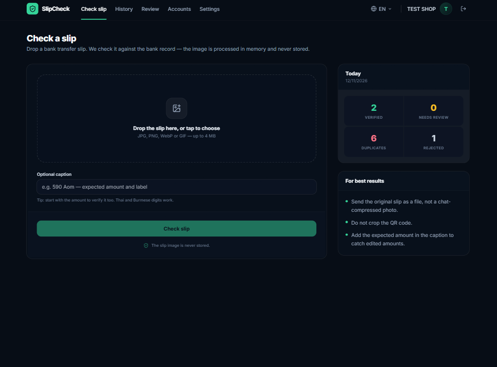
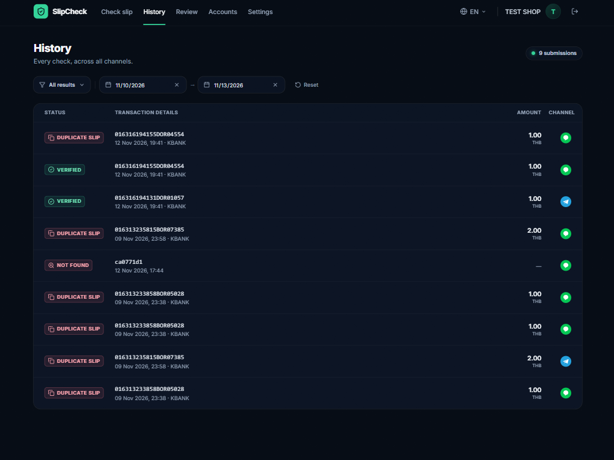
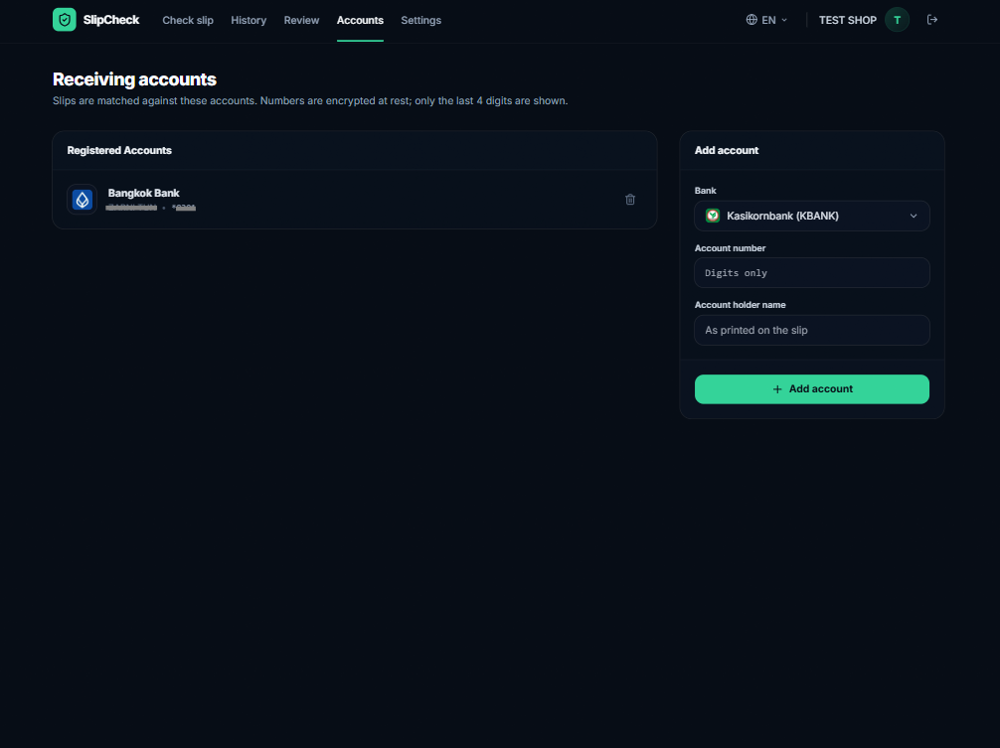
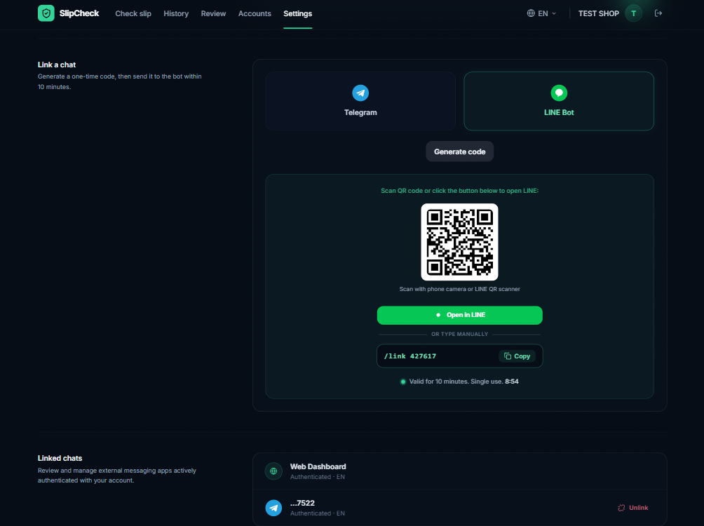
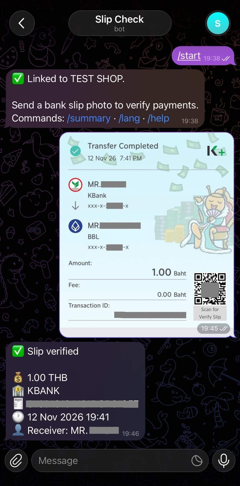
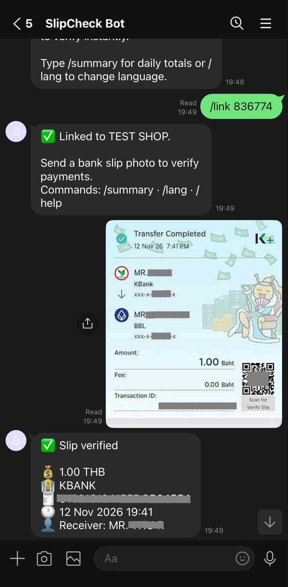

<div align="center">

# 🧾 SlipCheck

### Payment Slip Verification SaaS for Thai Online Sellers

Automated bank transfer slip verification via **Web Dashboard**, **Telegram Bot**, and **LINE Bot**,
with native multi-language support in **English**, **ไทย**, and **မြန်မာ**.


[Overview](#overview) •
[Showcase](#showcase) •
[Features](#features) •
[Architecture](#architecture) •
[ADRs](#adrs) •
[Quick Start](#quick-start)

</div>

---

<a id="overview"></a>
## 📌 Project Overview & Problem Statement

Online sellers in Thailand process dozens to hundreds of bank transfer slips daily via **PromptPay** and Thai bank mobile apps. Common pain points include:

| Pain Point | How SlipCheck Solves It |
|------------|-------------------------|
| 🎭 **Fake Slips** | Connects to interbank networks (via EasySlip API v2) to verify transaction existence and amounts in real time. |
| ♻️ **Reused Slips** | Atomic database locks enforce a strict 1-slip-per-seller rule, instantly flagging duplicates. |
| 🏦 **Wrong Accounts** | Validates the receiver's account number against the seller's registered, AES-encrypted bank accounts. |
| 🌏 **Language Barriers** | Provides dynamic dashboard and bot responses in English, Thai, and Burmese so non-Thai staff can process orders seamlessly. |

---

<a id="showcase"></a>
## 📸 Platform Showcase

### Web Dashboard
*A premium SaaS React frontend with split-pane layouts, glassmorphism UI, and custom headless components.*

| **Slip Check (Verification)** | **Transaction History** |
|:---:|:---:|
|  |  |
| *Drag-and-drop instant verification with granular verdicts.* | *Compact date filtering and pagination for daily reconciliations.* |

| **Bank Accounts** | **Settings & 1-Click Linking** |
|:---:|:---:|
|  |  |
| *AES-256-GCM encrypted bank account management.* | *Live UI polling with QR deep links for instant bot connection.* |

### Multi-Channel Bot Integrations
*Sellers verify slips on the go without leaving their favorite chat apps.*

<table>
  <tr>
    <th align="center">Telegram Bot</th>
    <th align="center">LINE Official Account</th>
  </tr>
  <tr>
    <td align="center">
      
    </td>
    <td align="center">
      
    </td>
  </tr>
  <tr>
    <td align="center"><i>Rich multi-line replies, inline keyboards, and deep linking.</i></td>
    <td align="center"><i>Push notifications, quick replies, and OA messaging.</i></td>
  </tr>
</table>

---

<a id="features"></a>
## ✨ Key Features

- **📲 1-Click QR Chat Linking**: Seamlessly connect Telegram and LINE accounts using camera QR scanning or universal deep links (`/start <code>`). The React UI uses live polling to auto-update the dashboard the moment a phone scans the code.
- **🧠 Smart Language Synchronization**: When a user links their bot, the backend detects their web-dashboard language preference (English, Thai, Burmese) and immediately greets them in their native language.
- **🧾 Instant Slip Verification**: Sub-2-second verification powered by EasySlip API v2, with local EMVCo payload parsing fallbacks.
- **🔔 Proactive Push Notifications**: Rich, multi-line slip summaries (Amount, Bank, Receiver, Ref) and instant push alerts across all channels if a shop unlinks a chat.
- **🛡️ Enterprise-Grade Security**:
  - **Zero Disk Storage**: Slip images are processed strictly in memory (`byte[]`) and never stored on disk or in the DB.
  - **AES-256-GCM**: Bank account numbers are encrypted at rest.
  - **Exact Financial Math**: Zero floating-point drift. All money is calculated in integer **Satang** (`bigint`).
  - **Constant-time HMAC Verification**: LINE and Telegram webhook request verification.

---

<a id="architecture"></a>
## 🏗️ System Architecture

```text
┌─────────────────┐      ┌─────────────────┐      ┌─────────────────┐
│   Telegram Bot  │      │    LINE Bot     │      │   Web Dashboard │
└────────┬────────┘      └────────┬────────┘      └────────┬────────┘
         │                        │                        │
         ▼                        ▼                        ▼
┌───────────────────────────────────────────────────────────────────┐
│                         Spring Boot Core                          │
│ ┌───────────────────────────────────────────────────────────────┐ │
│ │ Channel Adapters (Telegram / LINE / Web REST Controllers)     │ │
│ ├───────────────────────────────────────────────────────────────┤ │
│ │ Core Verification Pipeline (Channel-Agnostic)                 │ │
│ │ 1. Image Check -> 2. Caption Parse -> 3. QR Decoder           │ │
│ │ 4. Provider Call -> 5. Receiver Match -> 6. Atomic DB Claim   │ │
│ ├───────────────────────────────────────────────────────────────┤ │
│ │ Security & Storage Layer                                      │ │
│ │ - AES-256-GCM Encrypted Accounts  - Atomic Unique Locks       │ │
│ │ - Zero Image Storage              - Append-Only Audit Log     │ │
│ └───────────────────────────────────────────────────────────────┘ │
└─────────────────────────────────┬─────────────────────────────────┘
                                  │
                  ┌───────────────┼───────────────┐
                  ▼               ▼               ▼
           ┌────────────┐  ┌────────────┐  ┌────────────┐
           │ PostgreSQL │  │  EasySlip  │  │  Mock      │
           │  (Flyway)  │  │   v2 API   │  │  Fallback  │
           └────────────┘  └────────────┘  └────────────┘
```

---

## 🔌 Provider Integration: EasySlip v2 & Smart Mock Fallback

SlipCheck supports both a live production banking provider and a local developer mock.

### 1. Production Provider: EasySlip API v2
Integrated the EasySlip v2 API as the primary verification service:
- **18+ Thai Bank Support:** Verification across all major Thai banks.
- **Account & Amount Matching:** Native capabilities to validate receiver account numbers and expected transfer amounts.

### 2. Development Provider: Smart MockProvider
Ensures zero-cost testing and automated CI execution without consuming paid API credits (`provider.name=mock`):
- **Deterministic Magic Payloads:** Triggers specific responses via prefixes (e.g., `MOCK_OK_200_1234`, `MOCK_NOT_FOUND`, `MOCK_PENDING`).
- **Free Local QR Scanner Fallback:** Automatically detects real Thai EMVCo QR payloads and verifies the QR structure locally without internet or API keys, enabling end-to-end UI testing for free.

---

<a id="adrs"></a>
## 🏛️ Architecture Decision Records (ADR Summary)

| ADR | Decision | Summary |
|-----|----------|---------|
| **ADR&#8209;1** | Persistence-Backed Retries | Transient provider failures (`PENDING`, `UNAVAILABLE`) set `status=RETRY_SCHEDULED`. `RetryJob` re-executes retries on a configurable schedule, guaranteeing retries survive application restarts. |
| **ADR&#8209;2** | Zero QR Payload Persistence | To strictly enforce seller privacy and PDPA compliance, QR payloads are processed in memory and never saved to the database or log files. |
| **ADR&#8209;3** | Flyway Schema Ownership | PostgreSQL Flyway migrations (`V1__init.sql`) serve as the single source of truth. Hibernate's automatic DDL generation is disabled. |
| **ADR&#8209;4** | DB-Level Duplicate Protection | Duplicate prevention is enforced via a SQL `UNIQUE` constraint on `claimed_transactions`. Slips are claimed directly in an atomic transaction, eliminating race conditions. |
| **ADR&#8209;5** | Encrypted Accounts | Bank account numbers are encrypted at rest using AES-256-GCM. The API layer only exposes the last 4 digits. |
| **ADR&#8209;6** | Native Multi-Language i18n | User-facing messages are driven by `messages_{en,th,my}.properties`. Burmese and Thai translations are natively authored strings containing rich multi-line UI formatting via `\n`. |

---

## 🛠️ Tech Stack

| Layer | Technology |
|-------|------------|
| **Backend** | Java 21, Spring Boot 3.4.x, Spring Security, Spring Data JPA |
| **Database** | PostgreSQL 17, Flyway Migration |
| **Authentication** | JWT (HMAC-SHA256 via jjwt 0.12.x), BCrypt password hashing |
| **Encryption & Security** | AES-256-GCM (`javax.crypto`), Rate Limiting (Bucket4j) |
| **Frontend** | React 19, Vite, TypeScript, Tailwind CSS, Headless UI, i18next |
| **Integrations** | EasySlip v2 API, Telegram Webhooks, LINE Messaging API |
| **Containerization** | Docker, Multi-stage Dockerfile (Eclipse Temurin 21 JRE) |

---

<a id="quick-start"></a>
## 🚀 Quick Start

### 1. Environment Setup

Create a `.env` file in the root directory:

```env
# Database
DB_URL=jdbc:postgresql://localhost:5432/slipcheck
DB_USER=postgres
DB_PASSWORD=postgres

# Security
JWT_SECRET=your-32-byte-minimum-random-jwt-secret-key
ENCRYPTION_KEY_BASE64=your-32-byte-base64-aes-key

# Provider Configuration (easyslip | mock)
PROVIDER_NAME=easyslip
PROVIDER_API_KEY=your-easyslip-api-key-here
PROVIDER_BASE_URL=https://api.easyslip.com/v2/verify/bank

# Bot Integrations (Optional)
TELEGRAM_BOT_TOKEN=
LINE_CHANNEL_SECRET=
LINE_CHANNEL_ACCESS_TOKEN=
```

### 2. Running with Docker Compose

```bash
# Build and run all services (DB, Backend, Frontend)
docker compose up --build -d
```

Access the web app at `http://localhost:3000`.

### 3. Local Development

**Backend:**

```bash
cd backend
mvn spring-boot:run
```

**Frontend:**

```bash
cd frontend
npm install
npm run dev
```

---

## 📄 License

This project is open-source and available under the [MIT License](LICENSE).
